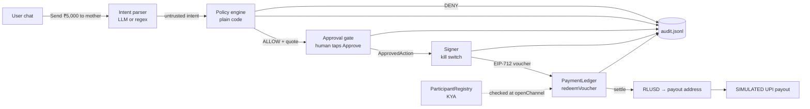

# XRP2India

**Send ₹5,000 to Mom in one sentence, with a spending limit the AI can't get around.**

XRP2India is a US→India remittance agent built for the XRPL Hackathon NYC (Agentic Finance track +
Mastercard **Agent Pay for Machines (AP4M)** challenge). You type *"Send ₹5,000 to my mother in India"*.
The agent prepares the payment inside a prefunded, capped channel. You tap **Approve**. An EIP-712 voucher is
redeemed and settles on the **XRPL EVM Sidechain testnet** (on our own AP4M-spec PaymentLedger with mock RLUSD; see
below), and a **SIMULATED** UPI payout screen shows what the recipient would see. Separately, the same agent pays for
its own small data purchases **autonomously** on the **live Mastercard AP4M platform**, inside a 2 RLUSD on-chain cap.

> Team RomsCoin (solo). Testnet only. Nothing here touches mainnet or real money.

## Mastercard AP4M (live platform)

Code: [`ap4m/README.md`](ap4m/README.md) · Proof with tx hashes: [`docs/AP4M-PROOF.md`](docs/AP4M-PROOF.md)

x402 transcript (402 challenge → policy → voucher → redeem → settle → receipt): [`docs/AP4M-X402-TRANSCRIPT.md`](docs/AP4M-X402-TRANSCRIPT.md)

- **On the AP4M platform, with AP4M-provided testnet RLUSD:** the agent's **autonomous corridor-quote purchases**.
  It gets HTTP 402, checks its policy, signs an x402 voucher and pays 0.25 RLUSD per USD→INR quote inside a
  2 RLUSD AP4M channel, with no human tap (3 purchases, 3 receipts that verify against the chain). Agent and merchant
  are registered through the AP4M service.
- **On our own PaymentLedger with MockRLUSD:** the **₹5,000 family remittance**, which always needs the human
  **Approve** tap. It runs there because our 20 RLUSD AP4M allocation is below the ~54 RLUSD it needs.
- **UPI payout is SIMULATED** in both cases.

**Who enforces which limit.** The **2 RLUSD AP4M channel cap is enforced on-chain by AP4M's PaymentLedger**: our
forced over-cap voucher was mined and **reverted** (tx `0xc1ba1b65…e388`, custom error `0xeeaa063e` with args
3.0 RLUSD requested vs 2.0 cap; we read the name as `VoucherExceedsChannelCap` **from a selector match**, because AP4M
does not publish the ABI. Reproduce with `npm run decode:revert`). The **approval gate, the ₹/$ per-payment and 24h limits
and the recipient allow-list are our app's controls**, enforced by our code and our own PaymentLedger, not by AP4M.

**Amounts.** *53.66 RLUSD* = the AP4M lane's prepared (unsent) quote at rate 94.94. *53.76 mRLUSD* = the earlier
human-approved settlement on our own ledger at rate 94.76. Different runs and ledgers; both are labelled in the proof docs.
The USD principal is rounded **up** to the cent (5000 / 94.94 = 52.6648… → $52.67; 5000 / 94.76 = 52.7649… → $52.77), plus a $0.99 fee,
so the recipient never gets less than the ₹ requested.

**Re-verify the proof (independently re-verified Sun Oct 25 2026, 10:40 AM ET):** `npm run verify:proof` checks every hash
in both proof docs over the testnet RPC (22 status 1, 2 intentional reverts, 8 IDs that are not transactions).

### Judge quickstart (5 minutes, no keys, no testnet funds)

```bash
npm ci
npm test                 # secret scan + contracts 25 + fallback 6 + agent 60 + web 13 + ap4m/scripts 21 (ap4m part needs Node ≥ 22.13)
npm run demo:local       # real contracts + EIP-712 vouchers on a local chain: ₹5,000 paid, 3 rejections, on-chain revert
npm run demo:local:web   # same, then the web app at http://127.0.0.1:3000 (Approve tap, progress, audit, SIMULATED UPI)
npm run verify:proof     # re-check every proof hash on XRPL EVM testnet (needs network access to the RPC)
npm run decode:revert    # decode the AP4M over-cap revert (needs network access to the RPC)
```

If the FX APIs are down the app uses the last good rate (<24h, timestamped), then a static rate labelled
**"Demo FX rate"** in amber. If the chain RPC is unreachable, the policy **fails closed** (`STATE_UNAVAILABLE`) and the
UI says so; nothing can be approved until the chain is readable again.

Pitch arc: **WHY → CONTROL → PAY → PROVE → BUILD**

## The problem (WHY)

Families in the US send billions of dollars a year home to India, and a meaningful slice still goes to fees,
FX spread and settlement delays. AI agents can now draft and send those payments for you, but "the model
promised not to overspend" is not a control. XRP2India shows the opposite: the agent can only spend inside a
**prefunded, on-chain cap**, a plain-code policy decides, and nothing moves until a human taps **Approve**.

## The demo in five beats

| Beat | What you see |
| --- | --- |
| **WHY** | "Send ₹5,000 to my mother in India" typed into a chat box |
| **CONTROL** | Channel cap + remaining (read from the contract), 24h budget, per-payment cap, allow-list, kill switch |
| **PAY** | Payment card (₹ amount, USD, fee line, RLUSD, live rate, masked UPI `•••@okaxis`) → **Approve** → EIP-712 voucher → `redeemVoucher` → `settle` |
| **PROVE** | Tx hashes with explorer links, `VoucherRedeemed` / `ClaimPaid` / `SettlementRecorded` events, audit log, **SIMULATED** UPI payout screen |
| **BUILD** | Same guardrails over a second rail (native XRPL Testnet) behind one env flag; contracts swappable for Mastercard's official AP4M deployment by config |

## How it works



Guardrail rule: **LLM proposes → plain-code policy decides → human approves → everything audited.**

```mermaid
sequenceDiagram
  participant H as Human
  participant A as Agent (server)
  participant P as Policy
  participant L as PaymentLedger (XRPL EVM testnet)
  H->>A: "Send ₹5,000 to my mother"
  A->>P: {recipient: mother, total: $57.81 at the static demo rate}
  P-->>A: ALLOW (per-tx, 24h, channel, allow-list)
  A-->>H: payment card (nothing has moved)
  H->>A: Approve
  A->>P: re-check with fresh state
  A->>A: gate mints single-use ApprovedAction; kill switch checked
  A->>L: redeemVoucher(EIP-712 voucher, cumulative amount)
  L-->>A: VoucherRedeemed
  A->>L: settle(channelId)
  L-->>A: ClaimPaid + SettlementRecorded (RLUSD to payout)
  A-->>H: tx hashes + explorer links + SIMULATED UPI screen
```

### AP4M mapping

| AP4M spec item | Where |
| --- | --- |
| KYA: only verified agents transact; payout bound | `ParticipantRegistry.register/isVerified/payoutOf`, checked in `PaymentLedger.openChannel` (and again at redeem, so revocation bites immediately) |
| Funded ASL: `openChannel()` locks RLUSD; `settled + redeemed ≤ cap` | `PaymentLedger.openChannel`, invariant `settled ≤ redeemed ≤ cap` tested |
| EIP-712 vouchers: `redeemVoucher()` verifies sig, monotonic cumulative watermark, `VoucherRedeemed` | `PaymentLedger.redeemVoucher`. Domain `AP4M PaymentLedger` v1 + chainId + verifyingContract. Voucher `(channelId, cumulativeAmount, nonce, deadline, ref)`. Rejects expired / zero deadline, replayed or reused nonce, wrong chain, wrong ledger, non-monotonic, over cap, revoked agent |
| Settlement: `settle()` pays `redeemed − settled`, `ClaimPaid` + `SettlementRecorded` | `PaymentLedger.settle` |

## What's real / what's simulated

| Piece | Status |
| --- | --- |
| **AP4M lane:** autonomous x402 quote purchases | **Real, on the AP4M hackathon platform**, AP4M-provided testnet RLUSD, AP4M's PaymentLedger / ParticipantRegistry ([proof](docs/AP4M-PROOF.md)) |
| AP4M 2 RLUSD channel cap | **Real, enforced on-chain by AP4M** (forced over-cap voucher reverted) |
| AP4M agent / merchant registration | Registered through the AP4M service |
| **Remittance lane:** ₹5,000 to Mom | **Real testnet transactions on our own PaymentLedger** with MockRLUSD, after a human Approve tap ([proof](docs/PROOF.md)); not on AP4M (20 RLUSD allocation < ~54 needed) |
| Policy engine (per-tx cap, 24h cap, channel cap, allow-list, kill switch) | Real, our app's controls, pure functions, unit-tested at under / at / over |
| Approval gate → typed, single-use `ApprovedAction` | Real; rails refuse anything the gate did not mint |
| EIP-712 voucher signing + on-chain verification | Real |
| ParticipantRegistry / PaymentLedger on XRPL EVM testnet | Real contracts (ours, AP4M-spec-compatible) |
| RLUSD | **MockRLUSD** (`mRLUSD`, 18 decimals by default, labelled **"mock RLUSD"** everywhere). The docs' "testnet RLUSD" `0x2093…E1eD` has no code on testnet |
| FX rate | Frankfurter (primary) → open.er-api (backup) → last good cached rate (<24h, with timestamp) → static **"Demo FX rate"** (₹88.00) |
| Intent parsing | Deterministic regex always; optional Claude structured-output parser when `ANTHROPIC_API_KEY` + `ANTHROPIC_MODEL` are set |
| UPI payout to India | **SIMULATED** (screen only, clearly labelled) |
| Fallback rail | Real native XRPL Testnet `Payment` (testnet XRP stands in for RLUSD at a fixed demo rate) |
| `mock` rail | Offline, in-memory, labelled **SIMULATED CHAIN** in UI; used for tests |

## What production needs

- A licensed Indian off-ramp / payout partner (RBI-regulated) and the US-side money-transmitter licensing; LRS/FEMA reporting.
- Sender KYC/AML, sanctions screening and Travel Rule data exchange, with **partner-confirmed coverage** (nothing here
  provides these today); recipient verification beyond a UPI handle.
- A remittance-sized AP4M allocation (or production AP4M access) so the remittance itself settles on AP4M, and
  production RLUSD instead of AP4M-provided testnet RLUSD / MockRLUSD. Contract addresses are config here.
- Approval on a hardware signer or passkey instead of a web button; key custody in an HSM/KMS.
- Separate admin / voucher-signer / relayer keys (HSM or MPC); the demo uses one testnet key for all three.
- Durable, tamper-evident audit store (append-only DB or on-chain hash anchoring) instead of a local JSONL file.
- Authenticated multi-user API (the demo server binds to `127.0.0.1` and has no auth).

## Run it

Prerequisites: Node 20+ (22 recommended), git, macOS or Linux. No Foundry or native solc needed.

### 1. Install and test (2 min)

```bash
git clone https://github.com/romaldesai/jarvis-xrpl.git && cd jarvis-xrpl
npm install
npm test                  # secret scan + 25 contract + 6 fallback + 60 agent + 13 web + 21 ap4m/script tests
```

### 2. Local demo, no testnet needed (1 command)

Real contracts and real EIP-712 vouchers on a local Hardhat chain:

```bash
npm run demo:local        # headless: pays ₹5,000, 3 REJECTED paths, on-chain over-cap revert, audit
npm run demo:local:web    # same chain, then opens the web app at http://127.0.0.1:3000
```

### 3. XRPL EVM Sidechain testnet: one command (Lane 1)

Needs Node 22+. Run on your Mac; nothing secret is ever printed.

```bash
npm run testnet            # or: ./scripts/testnet-demo.sh --yes  (pre-approve for rehearsals)
```

What it does, in order (safe to re-run; finished steps are skipped):

1. `wallet:new`: creates a throwaway agent key + payout address in `.env` if missing (prints addresses only).
2. Gas preflight: if the agent has 0 testnet XRP it stops and prints the faucet link
   (`https://faucet.xrplevm.org`, Testnet, up to ~90 XRP). Fund it, wait a minute, re-run.
3. Deploy MockRLUSD + ParticipantRegistry + PaymentLedger and KYA-register the agent → `contracts/deployments/xrplevmTestnet.json`
   (`REDEPLOY=1` to force).
4. Open a 500 mock-RLUSD channel (`REOPEN=1` to open another).
5. Payment: "Send ₹5,000 to my mother" → y/N approval → `redeemVoucher` → `settle`, explorer links printed; then three
   REJECTED paths: ₹50,000 over the cap, a non-allow-listed recipient, and the kill switch.
6. On-chain REJECTED proof: an over-cap voucher submitted with a fixed gas limit is mined and reverts `OverCap`.
7. Prints a **PASTE-BACK** block (contract addresses + tx hashes + explorer links, never keys).
   `npm run proof -- --write` saves it to `docs/PROOF.md`.

Individual steps if you prefer:

```bash
npm run wallet:new
npm run check              # gas preflight with faucet links
npm run deploy:testnet     # deploy + open channel
npm run balances           # gas, mock RLUSD balances, channel cap/redeemed/settled/nonce
npm run demo:headless      # payment + REJECTED paths
npm run prove:overcap      # on-chain over-cap revert
npm run proof              # paste-back block
```

Transactions are **legacy (type 0) with an explicit gasPrice** by default because some XRPL EVM testnet setups reject
EIP-1559 type-2 txs; set `EVM_TX_TYPE=eip1559` to switch.

To fund the channel from another wallet (for example the agent wallet `0xcBcc8c442d312D2D2b4B3d124d268fC235294e2C`,
registered through the AP4M service; it needs testnet gas first), put its key in `FUNDER_PRIVATE_KEY` in your local
`.env` before step 4. Without it, the agent wallet funds the channel (printed clearly).

To use Mastercard's official contracts when they arrive: set `AP4M_LEDGER_ADDRESS`, `AP4M_REGISTRY_ADDRESS`,
`RLUSD_ADDRESS`, `AP4M_CHANNEL_ID` (and `RLUSD_DECIMALS`, `RLUSD_LABEL=RLUSD`) in `.env`. If their ABI differs, only
`agent/src/rails/evm.ts` (`LEDGER_ABI`, `VOUCHER_TYPES`) changes.

Rehearse the exact testnet script offline:
`cd contracts && HARDHAT_CHAIN_ID=1449000 npx hardhat node --port 8546`, give the agent gas with `hardhat_setBalance`, then
`REHEARSE_RPC=http://127.0.0.1:8546 ./scripts/testnet-demo.sh --yes`. Delete the resulting
`contracts/deployments/xrplevmTestnet.json` and `audit.jsonl` afterwards so the fake deployment never gets committed.

### 4. Fallback: native XRPL Testnet

```bash
npm run wallet:xrpl               # faucet-funds a sender + payout on XRPL Testnet, writes .env (seed never printed)
SETTLEMENT_RAIL=xrpl npm run demo:headless
SETTLEMENT_RAIL=xrpl npm run dev
```

Proof links go to `https://testnet.xrpl.org/transactions/<hash>`.

### Kill switch

```bash
npm run kill -- on        # or the button in the web app; signer refuses everything
npm run kill -- off
KILL_SWITCH=1 npm run dev # hard kill from env (cannot be turned off from the UI)
```

Ledger-side kill switch: `PaymentLedger.pause()` (owner only) blocks open/redeem/settle on-chain.

## Agent API (for the web and fallback lanes)

`@xrp2india/agent` is a workspace package (TypeScript source, no build step). Server-side only: it reads keys from `.env`.

```ts
import { api } from "@xrp2india/agent";

// one-shot: parse + quote + policy, registers a pending payment. Nothing moves.
const card = await api.prepare("Send ₹5,000 to my mother in India");
// card.status: "awaiting_approval" | "denied" | "not_understood"
// card.quote: { inr, usd, fee, total, rlusd: "57.81 mock RLUSD", rate, rateLabel: "Live rate (frankfurter)" | "Demo FX rate", ... }
// card.decision: { allow, rule, reason }   card.upiMasked: "•••@okaxis"   card.budget: CONTROL numbers

// human tapped Approve -> typed, frozen, single-use ApprovedAction (throws ApprovalError with .rule on refusal)
const action = await api.approve(card.id!);

// sign EIP-712 voucher -> redeemVoucher -> settle (or XRPL Payment on SETTLEMENT_RAIL=xrpl)
const res = await api.redeemAndSettle(action, (step, d) => console.log(step, d?.txHash));
// res.settlement.proofs[]: { step, txHash, explorerUrl }   res.settlement.events[]: VoucherRedeemed / ClaimPaid / SettlementRecorded
// res.payout: { label: "SIMULATED", amountInr, upiMasked, reference }   res.budget: updated CONTROL numbers

api.reject(id);                      // human tapped Reject
await api.budget();                  // { display: { perTxCap, dailyRemaining, channelCap, channelRemaining }, ... }
api.readAudit(40);                   // newest-last audit events
api.killSwitch.isOn(); api.killSwitch.set(true);

// building blocks, all pure or side-effect-free:
await api.parseIntent(text);         // LLM (if configured) -> regex fallback
api.evaluatePolicy(proposal, cfg.policy, state);
await api.quote(intent);             // FX chain + fee + token base units
```

The class behind it is `RemittanceAgent` (`agent/src/service.ts`); `createAgentFromEnv()` builds one from `.env` +
`contracts/deployments/*.json`. A rail is anything implementing `Rail` in `agent/src/rails/types.ts`
(`info()`, `channelState()`, `execute(action, guard, onStep)`). The fallback lane's `XrplRail` must keep that shape
and call `guard.assertMaySign(action)` immediately before signing.

Lane ownership: `contracts/`, `agent/`, `scripts/` and this README's core = builder lane. `web/` = Lane 2.
`fallback/` = Lane 3. Testnet runs, `contracts/deployments/xrplevmTestnet.json` and `docs/PROOF.md` = Lane 1.

## Policy rules

Checked in this order; the first failing rule wins and is named in the UI and the audit log.

| Rule | Checks | When it trips |
| --- | --- | --- |
| `KILL_SWITCH` | `KILL_SWITCH` env or `killswitch.flag` file | Everything blocked, including already-prepared payments at approve time |
| `STATE_UNAVAILABLE` | Chain/RPC reachable, audit log readable | Fails closed: "Chain/RPC unreachable (or audit log unreadable)" |
| `INVALID_AMOUNT` / `NO_RECIPIENT` | Positive integer amount, recipient present | Denied |
| `RECIPIENT_NOT_ALLOWED` | Recipient alias in `POLICY_ALLOWED_RECIPIENTS` | Denied |
| `PER_TX_CAP` | total (principal + fee) ≤ `POLICY_PER_TX_CAP_USD_CENTS` (default $100) | Denied |
| `DAILY_CAP` | rolling 24h approved spend + total ≤ `POLICY_DAILY_CAP_USD_CENTS` (default $250); derived from `audit.jsonl`, survives restarts | Denied |
| `CHANNEL_CAP` | total ≤ channel `cap − redeemed` read from the contract | Denied (and the contract would revert `OverCap` anyway) |

Policy runs twice: when the card is prepared and again at approve time with fresh state. Approvals are serialized,
so two quick taps cannot both slip under the daily cap. Pending approvals expire after 10 minutes.

## Safety model

- **The LLM only proposes.** Its output is parsed into the same untrusted shape as the regex parser and validated by
  plain code. It never sees keys, never builds transactions, never decides a rule. Prompt injection ("ignore all rules")
  can at most change the proposal; the policy and the human still decide. The LLM is optional; the demo never depends on it.
- **One approval gate.** Only `ApprovalGate.approve()` can mint an `ApprovedAction`; it is frozen, tracked in a private
  `WeakSet`, and consumable exactly once. Rails call the sign guard (gate consumption + live kill-switch check)
  immediately before signing. A forged object is refused (tested).
- **On-chain cap.** Even a fully compromised agent key can redeem at most the channel `cap`, only to the KYA-bound payout
  address, and only while the agent is registered. The registry owner can revoke the agent; the ledger owner can pause.
- **Integers only.** USD cents, INR paise, RLUSD 18-decimal base units, XRP drops, all `bigint`. No floats touch money.
- **Fail closed.** Unreadable audit log, unreachable chain, invalid config, non-testnet chain ID or XRPL endpoint: block.
- **Audit.** Append-only `audit.jsonl`: prepare / deny / approve / redeem / settle / reject / fail / kill with rule, reason,
  tx hash and explorer link. The logger refuses fields named like keys/seeds/secrets.
- **Secrets.** Keys only in local `.env` (gitignored, mode 600). Scripts print addresses, never keys. A pre-commit and
  pre-push hook plus CI scan for 0x-prefixed 64-hex keys, XRPL seeds, PEM keys and API tokens.
- **Out of scope:** multi-user auth on the web server (it binds to localhost), hardware approval (stretch), real payout rails.

## Tests

```bash
npm test                         # everything below + secret scan + scripts/run-node-tests.mjs (ap4m + scripts)
npm test -w contracts            # 25: KYA, cap invariant, bad/tampered sig, wrong chain, wrong ledger, replayed + reused nonce, non-monotonic, expired + zero deadline, revoke, settle delta, pause, close/refund, 6/18 decimals
npm test -w agent                # 60: money, regex intents, quote rounding (18 + 6 dp), FX chain + cache, policy under/at/over, service end to end, split approve/settle API, kill switch, expiry, single-use, concurrency, restart, corrupt log
npm test -w fallback             # 6: testnet-only guard, drops math, guard-before-sign, result codes
npm test -w web                  # 13: API route handlers (prepare/approve/reject/kill) on the mock rail: happy path, ₹50,000 denied, bad/unknown/replayed id, kill switch, chain down
npm run test:node                # 21: ap4m policy (9, Node ≥ 22.13, skipped with a message on older Node), decode-revert (6), verify-proof (6)
```

## Repo layout

| Path | What |
| --- | --- |
| `contracts/` | Hardhat: `ParticipantRegistry`, `PaymentLedger`, `MockRLUSD`, tests, deploy + open-channel scripts |
| `agent/` | TypeScript agent: intent, quote, policy, approval gate, rails (`evm`, `mock`), audit, kill switch, `api.ts`, CLI scripts |
| `fallback/` | Native XRPL Testnet rail (xrpl.js) (Lane 3) |
| `web/` | Next.js demo UI + API routes; server holds keys, browser never does (Lane 2) |
| `ap4m/` | AP4M lane: autonomous x402 buyer, quote merchant, policy + tests, over-cap proof, `decode-revert.mjs` |
| `scripts/` | `secret-scan.mjs`, `local-demo.sh`, `testnet-demo.sh`, `verify-proof.mjs`, `run-node-tests.mjs` |
| `docs/PROOF.md` | Remittance lane (own PaymentLedger, MockRLUSD): testnet tx hashes (generated by `npm run proof -- --write`) |
| `docs/AP4M-PROOF.md` | AP4M lane: x402 purchases, receipts, decoded over-cap revert |

## Verified facts

| Fact | Value | Source | Verified |
| --- | --- | --- | --- |
| XRPL EVM Sidechain **testnet** chain ID | `1449000` (0x161c28). Note: `1440000` (on the venue slide) is **mainnet**; we do not use it | chainlist.org/chain/1449000, faucet.xrplevm.org, QuickNode XRPL EVM docs | 2026-10-24 |
| Testnet RPC | `https://rpc.testnet.xrplevm.org` | faucet.xrplevm.org, comparenodes.com | 2026-10-24 |
| Testnet explorer (Blockscout) | `https://explorer.testnet.xrplevm.org` | chainlist.org, explorer itself | 2026-10-24 |
| Testnet gas faucet | `https://faucet.xrplevm.org` | faucet.xrplevm.org | 2026-10-24 |
| Testnet RPC answers `eth_chainId` = `0x161c28` (1449000) | live check from outside the build sandbox | team research | 2026-10-25 |
| EIP-1559 type-2 txs reported rejected by some projects | default to legacy type-0 txs (`EVM_TX_TYPE`) | team research | 2026-10-25 |
| Docs' "testnet RLUSD" `0x20937978F265DC0C947AA8e136472CFA994FE1eD` | `eth_getCode` = `0x` (no contract) → MockRLUSD | team research | 2026-10-25 |
| FX primary `GET https://api.frankfurter.dev/v2/rate/USD/INR` | `{"base":"USD","quote":"INR","rate":94.76}`, no key | team research | 2026-10-25 |
| FX backup `GET https://open.er-api.com/v6/latest/USD` | `rates.INR` | team research | 2026-10-25 |
| XRPL native testnet WS | `wss://s.altnet.rippletest.net:51233` | xrpl.org | 2026-10-24 |
| All proof hashes in `docs/` | 22 status 1, 2 intentional reverts, 8 IDs (not txs); 3 AP4M receipts verified: true | independent re-check, `npm run verify:proof` | 2026-10-25 10:40 ET |
| AP4M over-cap revert `0xc1ba1b65…e388` | selector `0xeeaa063e`, args (3e18, 2e18); name `VoucherExceedsChannelCap` inferred by selector match (ABI unpublished) | `npm run decode:revert` | 2026-10-25 |

## Decisions

- **Hardhat over Foundry**: fastest to set up in the build sandbox; compiled with the npm `solc` package so
  no compiler download is needed.
- **Testnet chain ID 1449000, not 1440000**: the slide's 1440000 is XRPL EVM mainnet. Testnet only.
- **Our own spec-compatible AP4M contracts**: official SDK/addresses not yet received; addresses are
  pure config (`AP4M_*_ADDRESS`) so we can swap without code changes.
- **MockRLUSD, 18 decimals by default**: no RLUSD contract exists at the documented testnet address. 18 matches RLUSD on
  EVM chains; `RLUSD_DECIMALS=6` is supported end to end (contract, agent math, tests). The agent fails closed if the
  on-chain decimals differ from config. Labelled "mock RLUSD" in every display string.
- **Voucher = (channelId, cumulativeAmount, nonce, deadline, ref)**: the cumulative watermark and the strictly increasing
  nonce each block replay on their own; the deadline (default 10 min from the latest block) is mandatory.
- **Legacy type-0 transactions by default** (`EVM_TX_TYPE=legacy`), EIP-155 signed for chain 1449000.
- **FX chain**: Frankfurter → er-api → cached last good rate (<24h, `.fx-cache.json`) → static "Demo FX rate".
- **Testnet scripts are idempotent**: deploy/channel are skipped when the deployments file says they exist.
- **Caps in USD cents** (integers) in config; converted to RLUSD base units (×10^16) in code.
- **Voucher amount = principal + fee**, so the cap bounds everything the user pays. INR→USD rounds up, USD→INR rounds down.
- **Daily spend derived from the audit log** (approved minus failed-before-redeem), so it survives restarts.
  A payment whose redeem landed but whose settle failed stays counted; the next `settle()` pays the outstanding delta.
- **Agent wallet = contract admin + voucher signer + relayer** for the demo, to keep the testnet setup to one faucet
  drip. Production splits these roles.
- **EVM target `paris`** (no PUSH0) as a conservative choice for the sidechain.
- **ethers v6 provider with `cacheTimeout: -1` + NonceManager**: back-to-back redeem/settle otherwise reused a cached nonce.
- **Web server binds to 127.0.0.1** and has no auth; it is a single-user local demo.
- **Approve streams NDJSON progress** so the UI shows real chain steps rather than a fake spinner.
- **LLM model ID comes only from `ANTHROPIC_MODEL`**; if unset, the deterministic regex parser is used.
- **Fallback rail converts cents to testnet XRP drops at a fixed demo rate** (`XRPL_DROPS_PER_USD_CENT`, default 1000).

## Built with

Solidity 0.8.24 + OpenZeppelin 5 (Hardhat), TypeScript, ethers v6, xrpl.js 4, Next.js 15, Anthropic SDK (optional parser).

All feature code was built inside the event window (see commit history). Claude Code assisted. The
`hackathon-kit/` folder (skills/templates) predates the window; no feature code did.

## License

MIT
