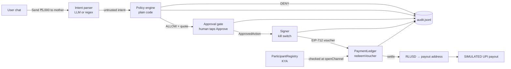

# XRP2India

**Send ₹5,000 to Mom in one sentence, with a spending limit the AI can't get around.**

XRP2India is a US→India remittance agent built for the XRPL Hackathon NYC (Agentic Finance track +
Mastercard **Agent Pay for Machines (AP4M)** challenge). You type *"Send ₹5,000 to my mother in India"*.
A KYA-verified agent prepares the payment inside a prefunded, capped channel. You tap **Approve**. An
EIP-712 voucher is redeemed, RLUSD settles on the **XRPL EVM Sidechain testnet**, and a **SIMULATED**
UPI payout screen shows what the recipient would see.

> Team RomsCoin (solo). Testnet only. Nothing here touches mainnet or real money.

Pitch arc: **WHY → CONTROL → PAY → PROVE → BUILD**

## The problem (WHY)

Families in the US send billions of dollars a year home to India, and a meaningful slice still goes to fees,
FX spread and settlement delays. AI agents can now draft and send those payments for you, but "the model
promised not to overspend" is not a control. XRP2India shows the opposite: the agent can only spend inside a
**prefunded, on-chain cap**, a plain-code policy decides, and nothing moves until a human taps **Approve**.

## The demo in five beats

| Beat | What you see |
| --- | --- |
| **WHY** | "Send ₹5,000 to my mother in India" typed into a chat box |
| **CONTROL** | Channel cap + remaining (read from the contract), 24h budget, per-payment cap, allow-list, kill switch |
| **PAY** | Payment card (₹ amount, USD, fee line, RLUSD, live rate, masked UPI `•••@okaxis`) → **Approve** → EIP-712 voucher → `redeemVoucher` → `settle` |
| **PROVE** | Tx hashes with explorer links, `VoucherRedeemed` / `ClaimPaid` / `SettlementRecorded` events, audit log, **SIMULATED** UPI payout screen |
| **BUILD** | Same guardrails over a second rail (native XRPL Testnet) behind one env flag; contracts swappable for Mastercard's official AP4M deployment by config |

## How it works



Guardrail rule: **LLM proposes → plain-code policy decides → human approves → everything audited.**

```mermaid
sequenceDiagram
  participant H as Human
  participant A as Agent (server)
  participant P as Policy
  participant L as PaymentLedger (XRPL EVM testnet)
  H->>A: "Send ₹5,000 to my mother"
  A->>P: {recipient: mother, total: $57.81}
  P-->>A: ALLOW (per-tx, 24h, channel, allow-list)
  A-->>H: payment card (nothing has moved)
  H->>A: Approve
  A->>P: re-check with fresh state
  A->>A: gate mints single-use ApprovedAction; kill switch checked
  A->>L: redeemVoucher(EIP-712 voucher, cumulative amount)
  L-->>A: VoucherRedeemed
  A->>L: settle(channelId)
  L-->>A: ClaimPaid + SettlementRecorded (RLUSD to payout)
  A-->>H: tx hashes + explorer links + SIMULATED UPI screen
```

### AP4M mapping

| AP4M spec item | Where |
| --- | --- |
| KYA: only verified agents transact; payout bound | `ParticipantRegistry.register/isVerified/payoutOf`, checked in `PaymentLedger.openChannel` (and again at redeem, so revocation bites immediately) |
| Funded ASL: `openChannel()` locks RLUSD; `settled + redeemed ≤ cap` | `PaymentLedger.openChannel`, invariant `settled ≤ redeemed ≤ cap` tested |
| EIP-712 vouchers: `redeemVoucher()` verifies sig, monotonic cumulative watermark, `VoucherRedeemed` | `PaymentLedger.redeemVoucher` (domain `AP4M PaymentLedger` v1, chainId, contract) |
| Settlement: `settle()` pays `redeemed − settled`, `ClaimPaid` + `SettlementRecorded` | `PaymentLedger.settle` |

## What's real / what's simulated

| Piece | Status |
| --- | --- |
| Policy engine (per-tx cap, 24h cap, channel cap, allow-list, kill switch) | Real, pure functions, unit-tested at under / at / over |
| Approval gate → typed, single-use `ApprovedAction` | Real; rails refuse anything the gate did not mint |
| EIP-712 voucher signing + on-chain verification | Real |
| ParticipantRegistry / PaymentLedger on XRPL EVM testnet | Real contracts (ours, AP4M-spec-compatible) |
| RLUSD | **MockRLUSD** (18 decimals, testnet faucet) until an official testnet RLUSD/AP4M address is confirmed |
| FX rate | Live free API (`open.er-api.com`), static fallback (₹88.00) if unreachable |
| Intent parsing | Deterministic regex always; optional Claude structured-output parser when `ANTHROPIC_API_KEY` + `ANTHROPIC_MODEL` are set |
| UPI payout to India | **SIMULATED** (screen only, clearly labelled) |
| Fallback rail | Real native XRPL Testnet `Payment` (testnet XRP stands in for RLUSD at a fixed demo rate) |
| `mock` rail | Offline, in-memory, labelled **SIMULATED CHAIN** in UI; used for tests |

## What production needs

- A licensed Indian off-ramp / payout partner (RBI-regulated) and the US-side money-transmitter licensing; LRS/FEMA reporting.
- Sender KYC/AML and sanctions screening; recipient verification beyond a UPI handle.
- Real RLUSD and Mastercard's official AP4M SDK/contracts (addresses are config here).
- Approval on a hardware signer or passkey instead of a web button; key custody in an HSM/KMS.
- Durable, tamper-evident audit store (append-only DB or on-chain hash anchoring) instead of a local JSONL file.
- Authenticated multi-user API (the demo server binds to `127.0.0.1` and has no auth).

## Run it

Prerequisites: Node 20+ (22 recommended), git, macOS or Linux. No Foundry or native solc needed.

### 1. Install and test (2 min)

```bash
git clone https://github.com/romaldesai/jarvis-xrpl.git && cd jarvis-xrpl
npm install
npm test                  # secret scan + 21 contract + 6 fallback + 48 agent tests
```

### 2. Local demo, no testnet needed (1 command)

Real contracts and real EIP-712 vouchers on a local Hardhat chain:

```bash
npm run demo:local        # headless: pays ₹5,000, then shows 3 guardrail denials + audit
npm run demo:local:web    # same chain, then opens the web app at http://127.0.0.1:3000
```

### 3. XRPL EVM Sidechain testnet (the live demo)

```bash
cp .env.example .env              # once
npm run wallet:new                # writes a throwaway agent key + payout address into .env (prints addresses only)
# Fund the printed agent address with testnet XRP gas: https://faucet.xrplevm.org (Testnet, chain 1449000)
npm run balances                  # confirm gas arrived
npm run deploy:testnet            # MockRLUSD + ParticipantRegistry + PaymentLedger, KYA-register agent, open a 500 RLUSD channel
npm run balances                  # shows channel cap / redeemed / settled
npm run demo:headless             # asks y/N, then settles and prints explorer links
npm run dev                       # web app at http://127.0.0.1:3000
```

Addresses and tx hashes land in `contracts/deployments/xrplevmTestnet.json` (public data, safe to commit).

To fund the channel from the **Mastercard-registered funding wallet** `0xcBcc8c442d312D2D2b4B3d124d268fC235294e2C`, put its key in
`FUNDER_PRIVATE_KEY` in your local `.env` (give it a little testnet gas too) before `npm run deploy:testnet`.
Without it, the agent wallet funds the channel (demo fallback; printed clearly).

To use Mastercard's official contracts when they arrive: set `AP4M_LEDGER_ADDRESS`, `AP4M_REGISTRY_ADDRESS`,
`RLUSD_ADDRESS`, `AP4M_CHANNEL_ID` in `.env`. If their ABI differs, only `agent/src/rails/evm.ts` (`LEDGER_ABI`) changes.

### 4. Fallback: native XRPL Testnet

```bash
npm run wallet:xrpl               # faucet-funds a sender + payout on XRPL Testnet, writes .env (seed never printed)
SETTLEMENT_RAIL=xrpl npm run demo:headless
SETTLEMENT_RAIL=xrpl npm run dev
```

Proof links go to `https://testnet.xrpl.org/transactions/<hash>`.

### Kill switch

```bash
npm run kill -- on        # or the button in the web app; signer refuses everything
npm run kill -- off
KILL_SWITCH=1 npm run dev # hard kill from env (cannot be turned off from the UI)
```

Ledger-side kill switch: `PaymentLedger.pause()` (owner only) blocks open/redeem/settle on-chain.

## Policy rules

Checked in this order; the first failing rule wins and is named in the UI and the audit log.

| Rule | Checks | When it trips |
| --- | --- | --- |
| `KILL_SWITCH` | `KILL_SWITCH` env or `killswitch.flag` file | Everything blocked, including already-prepared payments at approve time |
| `STATE_UNAVAILABLE` | Audit log readable, chain reachable | Fails closed |
| `INVALID_AMOUNT` / `NO_RECIPIENT` | Positive integer amount, recipient present | Denied |
| `RECIPIENT_NOT_ALLOWED` | Recipient alias in `POLICY_ALLOWED_RECIPIENTS` | Denied |
| `PER_TX_CAP` | total (principal + fee) ≤ `POLICY_PER_TX_CAP_USD_CENTS` (default $100) | Denied |
| `DAILY_CAP` | rolling 24h approved spend + total ≤ `POLICY_DAILY_CAP_USD_CENTS` (default $250); derived from `audit.jsonl`, survives restarts | Denied |
| `CHANNEL_CAP` | total ≤ channel `cap − redeemed` read from the contract | Denied (and the contract would revert `OverCap` anyway) |

Policy runs twice: when the card is prepared and again at approve time with fresh state. Approvals are serialized,
so two quick taps cannot both slip under the daily cap. Pending approvals expire after 10 minutes.

## Safety model

- **The LLM only proposes.** Its output is parsed into the same untrusted shape as the regex parser and validated by
  plain code. It never sees keys, never builds transactions, never decides a rule. Prompt injection ("ignore all rules")
  can at most change the proposal; the policy and the human still decide. The LLM is optional; the demo never depends on it.
- **One approval gate.** Only `ApprovalGate.approve()` can mint an `ApprovedAction`; it is frozen, tracked in a private
  `WeakSet`, and consumable exactly once. Rails call the sign guard (gate consumption + live kill-switch check)
  immediately before signing. A forged object is refused (tested).
- **On-chain cap.** Even a fully compromised agent key can redeem at most the channel `cap`, only to the KYA-bound payout
  address, and only while the agent is registered. The registry owner can revoke the agent; the ledger owner can pause.
- **Integers only.** USD cents, INR paise, RLUSD 18-decimal base units, XRP drops, all `bigint`. No floats touch money.
- **Fail closed.** Unreadable audit log, unreachable chain, invalid config, non-testnet chain ID or XRPL endpoint: block.
- **Audit.** Append-only `audit.jsonl`: prepare / deny / approve / redeem / settle / reject / fail / kill with rule, reason,
  tx hash and explorer link. The logger refuses fields named like keys/seeds/secrets.
- **Secrets.** Keys only in local `.env` (gitignored, mode 600). Scripts print addresses, never keys. A pre-commit and
  pre-push hook plus CI scan for 0x-prefixed 64-hex keys, XRPL seeds, PEM keys and API tokens.
- **Out of scope:** multi-user auth on the web server (it binds to localhost), hardware approval (stretch), real payout rails.

## Tests

```bash
npm test                         # everything below + secret scan
npm test -w contracts            # 21: KYA, cap invariant, bad/tampered/cross-domain sig, replay, non-monotonic, expiry, revoke, settle delta, pause, close/refund
npm test -w agent                # 48: money, regex intents, quote rounding + FX fallback, policy under/at/over, service end to end, kill switch, expiry, single-use, concurrency, restart, corrupt log
npm test -w fallback             # 6: testnet-only guard, drops math, guard-before-sign, result codes
```

## Repo layout

| Path | What |
| --- | --- |
| `contracts/` | Hardhat: `ParticipantRegistry`, `PaymentLedger`, `MockRLUSD`, tests, deploy + open-channel scripts |
| `agent/` | TypeScript agent: intent, quote, policy, approval gate, rails (`evm`, `mock`), audit, kill switch, CLI scripts |
| `fallback/` | Native XRPL Testnet rail (xrpl.js) |
| `web/` | Next.js demo UI + API routes (server holds keys; browser never does) |
| `scripts/` | `secret-scan.mjs`, `local-demo.sh` |

## Verified facts

| Fact | Value | Source | Verified |
| --- | --- | --- | --- |
| XRPL EVM Sidechain **testnet** chain ID | `1449000` (0x161c28). Note: `1440000` (on the venue slide) is **mainnet**; we do not use it | chainlist.org/chain/1449000, faucet.xrplevm.org, QuickNode XRPL EVM docs | 2026-10-24 |
| Testnet RPC | `https://rpc.testnet.xrplevm.org` | faucet.xrplevm.org, comparenodes.com | 2026-10-24 |
| Testnet explorer (Blockscout) | `https://explorer.testnet.xrplevm.org` | chainlist.org, explorer itself | 2026-10-24 |
| Testnet gas faucet | `https://faucet.xrplevm.org` | faucet.xrplevm.org | 2026-10-24 |
| RLUSD on XRPL EVM testnet | Not confirmed; using MockRLUSD (18 decimals) | docs.ripple.com token-addresses lists one XRPL EVM address without network label | 2026-10-24 |
| XRPL native testnet WS | `wss://s.altnet.rippletest.net:51233` | xrpl.org | 2026-10-24 |

## Decisions

- **Hardhat over Foundry**: fastest to set up in the build sandbox; compiled with the npm `solc` package so
  no compiler download is needed.
- **Testnet chain ID 1449000, not 1440000**: the slide's 1440000 is XRPL EVM mainnet. Testnet only.
- **Our own spec-compatible AP4M contracts**: official SDK/addresses not yet received; addresses are
  pure config (`AP4M_*_ADDRESS`) so we can swap without code changes.
- **MockRLUSD (18 decimals)**: no verified RLUSD deployment on XRPL EVM testnet.
- **Caps in USD cents** (integers) in config; converted to RLUSD base units (×10^16) in code.
- **Voucher amount = principal + fee**, so the cap bounds everything the user pays. INR→USD rounds up, USD→INR rounds down.
- **Daily spend derived from the audit log** (approved minus failed-before-redeem), so it survives restarts.
  A payment whose redeem landed but whose settle failed stays counted; the next `settle()` pays the outstanding delta.
- **Agent wallet = contract admin + voucher signer + relayer** for the demo, to keep the testnet setup to one faucet
  drip. Production splits these roles.
- **EVM target `paris`** (no PUSH0) as a conservative choice for the sidechain.
- **ethers v6 provider with `cacheTimeout: -1` + NonceManager**: back-to-back redeem/settle otherwise reused a cached nonce.
- **Web server binds to 127.0.0.1** and has no auth; it is a single-user local demo.
- **Approve streams NDJSON progress** so the UI shows real chain steps rather than a fake spinner.
- **LLM model ID comes only from `ANTHROPIC_MODEL`**; if unset, the deterministic regex parser is used.
- **Fallback rail converts cents to testnet XRP drops at a fixed demo rate** (`XRPL_DROPS_PER_USD_CENT`, default 1000).

## Built with

Solidity 0.8.24 + OpenZeppelin 5 (Hardhat), TypeScript, ethers v6, xrpl.js 4, Next.js 15, Anthropic SDK (optional parser).

All feature code was built inside the event window (see commit history). Claude Code assisted. The
`hackathon-kit/` folder (skills/templates) predates the window; no feature code did.

## License

MIT
