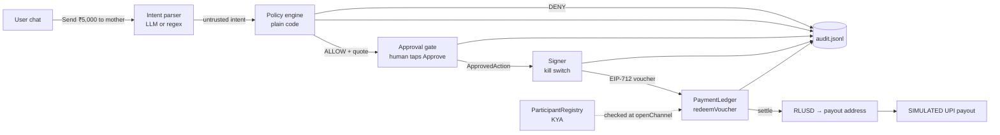

# XRP2India

**Send ₹5,000 to Mom in one sentence, with a spending limit the AI can't get around.**

XRP2India is a US→India remittance agent built for the XRPL Hackathon NYC (Agentic Finance track +
Mastercard **Agent Pay for Machines (AP4M)** challenge). You type *"Send ₹5,000 to my mother in India"*.
A KYA-verified agent prepares the payment inside a prefunded, capped channel. You tap **Approve**. An
EIP-712 voucher is redeemed, RLUSD settles on the **XRPL EVM Sidechain testnet**, and a **SIMULATED**
UPI payout screen shows what the recipient would see.

> Team RomsCoin (solo). Testnet only. Nothing here touches mainnet or real money.

Pitch arc: **WHY → CONTROL → PAY → PROVE → BUILD**

## The problem (WHY)

TODO: 2-3 sentences: US→India corridor size, fees, days-to-settle, and why letting an AI agent move
money needs hard limits, not prompts.

## How it works



Guardrail rule: **LLM proposes → plain-code policy decides → human approves → everything audited.**

## What's real / what's simulated

| Piece | Status |
| --- | --- |
| Policy engine (per-tx cap, daily cap, allow-list, kill switch) | Real, unit-tested |
| EIP-712 voucher signing + on-chain verification | Real |
| ParticipantRegistry / PaymentLedger / RLUSD on XRPL EVM testnet | Real contracts (ours, spec-compatible); **MockRLUSD** token until official RLUSD/AP4M addresses are confirmed |
| FX rate | Live free API, static fallback |
| UPI payout to India | **SIMULATED** (screen only) |
| KYC of the human sender | Out of scope |

## What production needs

TODO: licensed off-ramp partner in India (RBI/LRS), real RLUSD, official AP4M contracts, sender KYC/AML,
HSM/hardware-wallet approval, durable audit store, rate-limit/fraud signals.

## Run it

TODO: filled in per checkpoint (install, .env, wallet, deploy, demo).

```bash
npm install
npm test
```

## Policy rules

TODO: table.

## Safety model

TODO.

## Verified facts

| Fact | Value | Source | Verified |
| --- | --- | --- | --- |
| XRPL EVM Sidechain **testnet** chain ID | `1449000` (0x161c28). Note: `1440000` (on the venue slide) is **mainnet**; we do not use it | chainlist.org/chain/1449000, faucet.xrplevm.org, QuickNode XRPL EVM docs | 2026-10-24 |
| Testnet RPC | `https://rpc.testnet.xrplevm.org` | faucet.xrplevm.org, comparenodes.com | 2026-10-24 |
| Testnet explorer (Blockscout) | `https://explorer.testnet.xrplevm.org` | chainlist.org, explorer itself | 2026-10-24 |
| Testnet gas faucet | `https://faucet.xrplevm.org` | faucet.xrplevm.org | 2026-10-24 |
| RLUSD on XRPL EVM testnet | Not confirmed; using MockRLUSD (18 decimals) | docs.ripple.com token-addresses lists one XRPL EVM address without network label | 2026-10-24 |
| XRPL native testnet WS | `wss://s.altnet.rippletest.net:51233` | xrpl.org | 2026-10-24 |

## Decisions

- **Hardhat over Foundry**: fastest to set up in the build sandbox; compiled with the npm `solc` package so
  no compiler download is needed.
- **Testnet chain ID 1449000, not 1440000**: the slide's 1440000 is XRPL EVM mainnet. Testnet only.
- **Our own spec-compatible AP4M contracts**: official SDK/addresses not yet received; addresses are
  pure config (`AP4M_*_ADDRESS`) so we can swap without code changes.
- **MockRLUSD (18 decimals)**: no verified RLUSD deployment on XRPL EVM testnet.
- **Caps in USD cents** (integers) in config; converted to RLUSD base units (×10^16) in code.

## Built with

Built inside the event window (see commit history). Claude Code assisted. The hackathon-kit folder
(skills/templates) predates the window; no feature code did.

## License

MIT
