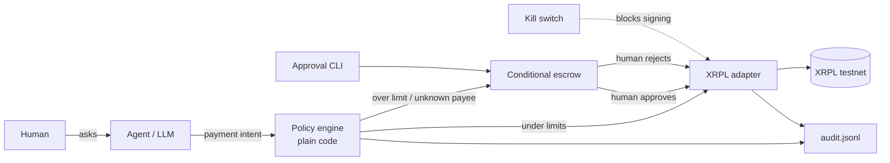
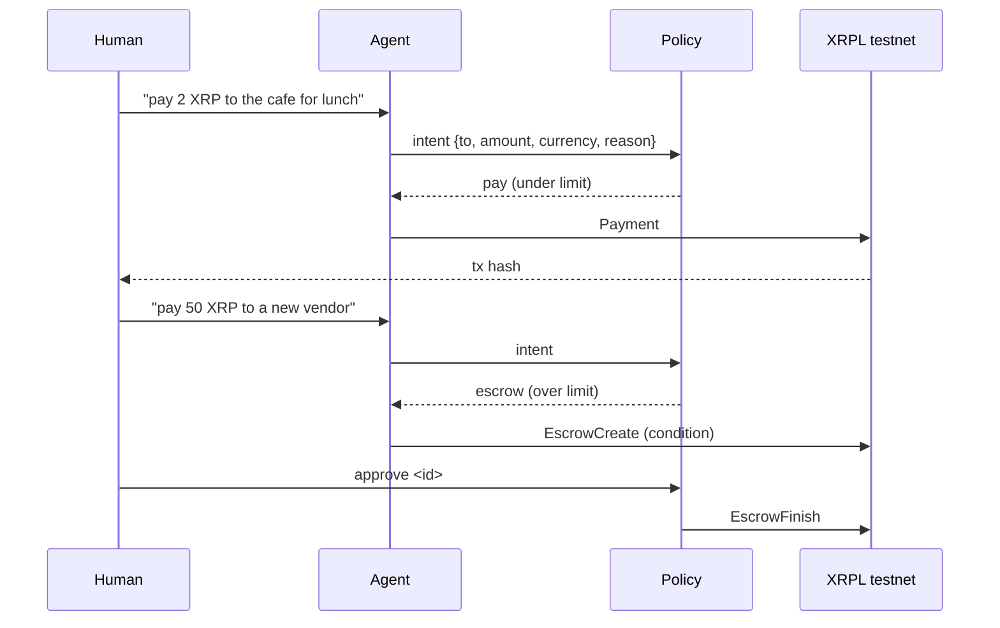

# Hackathon demo pack

Judging criteria to design for: **Idea, Implementation (a live testnet transaction, not slides),
Demo and Pitch, Potential.** Every artifact here should make one of those four easier to score.

## README skeleton (must run from a clean clone)

1. Title, one-line pitch, and a badge-free first screen: what it is and why it matters.
2. **The problem** in two or three sentences.
3. **What it does**: the three behaviours (auto-pay under the limit, human approval over it,
   kill switch) and that every decision is audited.
4. **Architecture** diagram (Mermaid, below) and a short walkthrough of one request.
5. **Demo**: link to the video, a GIF or screenshots, and real testnet transaction hashes with
   explorer links.
6. **Run it** from a clean clone: prerequisites, install, copy `.env.example` to `.env`, fund
   testnet wallets, run tests, run the one-command demo. Expected output for each step.
7. **Policy rules** as a table: rule, what it checks, what happens when it trips.
8. **Safety model and threat model**: what the model can and cannot do, where each key lives,
   what happens if the agent is prompt-injected or its key is stolen, and what is out of scope.
9. **Tests**: what is covered and how to run it.
10. **Limitations and roadmap**: honest, including what is testnet-only.
11. **Built with**: say plainly that the base assistant existed before the event and that the
    XRPL feature was built inside the event window (the commit history shows it), and that Claude
    Code assisted. Judges respect honesty.
12. License (MIT).

No personal information, no real keys, no mainnet anything.

## Mermaid templates (renders natively on GitHub)

Architecture:

Demo flow (sequence):

Transaction timeline: generate a table from the audit log (time, intent id, rule hit, decision,
hash). Keep the generator a tiny script so the timeline in the README is real, not drawn.

Rules for diagrams: one idea per diagram, five to nine boxes, labels a stranger understands,
no secrets or personal data, and an SVG export committed next to the Mermaid source if a slide
needs it.

## Demo script (3 minutes, adjust to the slot)

| Time | Beat | On screen |
| --- | --- | --- |
| 0:00 | Hook: "AI agents can pay now. What stops them paying the wrong person?" | Title |
| 0:20 | The idea in one sentence and the architecture diagram | Diagram |
| 0:40 | **Auto-pay**: small payment under the limit, live, with the hash opened in the explorer | Terminal + explorer |
| 1:20 | **Over the limit**: escrow is created, nothing has moved yet; show the pending item | Terminal |
| 1:45 | Human runs `approve <id>`: funds release; then show a second one and `reject <id>` | Terminal + explorer |
| 2:15 | **Kill switch**: block signing, show the agent cannot pay, show the key rotation result | Terminal |
| 2:40 | The audit log: every decision with the rule that fired | `audit.jsonl` |
| 2:50 | Close: why this matters, what is next (stretch goals only if they exist) | Title |

Demo discipline:
- Everything rehearsed at least three times on the actual machine and network.
- Pre-fund wallets and keep a reserve. Run the pre-demo checklist from the builder skill.
- Have a **recorded backup** of the happy path, to be used only if the live run fails, and say so.
- Never show `.env`, terminals with secrets, browser profiles or personal tabs. Use a clean
  desktop, hide notifications, and close personal apps.

## Video storyboard template (60 to 90 seconds)

| # | Shot | On-screen text | Voice-over (one sentence) | Seconds |
| --- | --- | --- | --- | --- |
| 1 | Title card | Project name, one-liner | The hook | 5 |
| 2 | Architecture diagram | Three boxes labelled | How it works | 10 |
| 3 | Terminal: auto-pay | "Under the limit: paid" | What happens | 15 |
| 4 | Terminal: over limit then approve | "Over the limit: held in escrow" | The safeguard | 20 |
| 5 | Terminal: kill switch | "Kill switch: signing blocked" | The emergency stop | 10 |
| 6 | Explorer + audit log | Real hashes | Proof | 10 |
| 7 | End card | Repo URL | Where to find it | 5 |

The owner records the screen and voice. Keep captions on for sound-off viewing.

## Slides (3 to 5 only)

1. **Problem and idea**: one sentence each, one image.
2. **How it works**: the architecture diagram.
3. **Proof**: live transaction hashes, the three behaviours, the audit log excerpt.
4. **Why it matters / potential**: who needs this, why now, path from testnet to production.
5. **Roadmap and ask** (only if time): next steps, what help is wanted.

Design: large text, one message per slide, consistent two-colour palette, no clip-art, no
third-party logos beyond naming the technologies factually.

## Cover image and logo brief

Simple, flat, readable at 64 px. A shield or lock mark with a payment arrow. Two colours plus
neutral. Delivered as SVG (and a PNG for social cards). No trademarked marks, no personal photos.

## Judge Q&A bank (format: claim, evidence, limitation)

Prepare a crisp answer for each:
- How is this different from a spending limit in a bank or wallet app?
- What if the model is prompt-injected into proposing a bad payment?
- What if the agent's key is stolen?
- Why escrow and not multi-signature? Why a hash-lock?
- Where does the approval secret live, and who can release funds?
- What does the hardware wallet add, and what happens without it?
- Why testnet only, and what changes for mainnet?
- How are daily limits enforced across restarts?
- What did you build in the window and what existed before?
- What is the business or ecosystem value, and who is the first user?

Answer shape: one-sentence claim, point to the file, test or transaction that proves it, then
state the honest limitation. Never bluff: "not built yet, here is how" is a good answer.

## Submission checklist (fill in once the organizers confirm the fields)

- [ ] Repo is public, opens logged-out, has README, LICENSE, `.env.example`
- [ ] Clean-clone test passed after the final commit; tag `v1.0-submission` pushed
- [ ] Demo video uploaded and link opens logged-out
- [ ] Slides exported (PDF) and linked
- [ ] Real testnet transaction hashes in the README resolve in the explorer
- [ ] Required form fields completed (list them here after check-in): ______
- [ ] Track and bounty selections entered as required
- [ ] Team names or details included only as the owner chooses; nothing else personal
- [ ] Final-hash recorded; submission made before the deadline with a time buffer
- [ ] Screenshot and video check: no secrets, no personal tabs, no notifications

## Time-box table (edit the hours once the plan is final)

| Block | Goal | Done when | Cut if late |
| --- | --- | --- | --- |
| Setup | Environment, repo, wallets funded | Client connects, wallets funded, suite runs | never |
| Policy engine | Rules and tests | Table tests green | never |
| Auto-pay | Payment under limit on testnet | Hash verified | never |
| Escrow + approve/reject | Conditional escrow with CLI approval | Both paths verified on testnet | never |
| Kill switch | Block signing, rotate key | Blocked agent cannot sign | on-chain rotation |
| One-command demo | Single script runs all behaviours | Runs clean twice | never |
| **Feature freeze** | No new features after this point | README and visuals only | n/a |
| README and diagrams | Clean-clone run steps | Clean-clone test passes | never |
| Video and slides | Storyboard, recording, slides | Links work | extra slides |
| Stretch (only after freeze) | Ledger, then credentials, then stable-coin | Only if everything above is green | all of it |
| Buffer and rehearsal | Three demo rehearsals | Backup video exists | never |

Enforcement: at each block boundary, state what is done, what is behind, and what gets cut.
Cutting early beats a broken demo.
